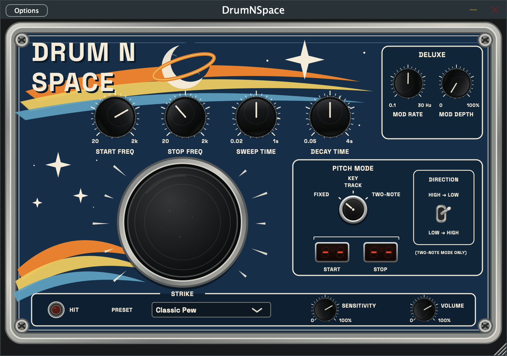

# DrumNSpace

A retro analog "space drum" synth plugin — the classic pitch-swept *pew* of 70s/80s drum synths — built with JUCE 8. Available as **AU**, **VST3**, and **Standalone** app.



## Features

- **Pitch sweep** — Start Freq → Stop Freq (20 Hz – 2 kHz) over Sweep Time, with Decay Time up to 4 s
- **Deluxe mod** — LFO pitch wobble via Mod Rate (0.1–30 Hz) and Mod Depth
- **Pitch modes**
  - **Fixed** — every note plays the same sweep
  - **Key Track** — sweep transposes with the key (C3 / MIDI 60 = unshifted)
  - **Two-Note** — hold two keys; the sweep glides between them. Direction toggle picks High → Low or Low → High. One key held falls back to Key Track
- **Velocity Sensitivity** — 0% = every hit full level, 100% = fully velocity-scaled
- **Strike pad** — click to play; centre hits hardest, edge hits softer
- **25 factory presets** (Classic Pew, Warp Drive, Tractor Beam, Key Track Zap, …)

## Requirements

- macOS (the CMake config targets AU; VST3/Standalone builds on other platforms should work but are untested)
- CMake ≥ 3.22
- A C++20 compiler (Xcode / Apple Clang)
- [JUCE 8](https://github.com/juce-framework/JUCE) (developed against 8.0.12)

## Building

JUCE isn't vendored — the build expects it at `./JUCE`. Clone it there, or symlink an existing checkout:

```sh
git clone https://github.com/eric-silverman/drumnspace.git
cd drumnspace

# either
git clone --depth 1 --branch 8.0.12 https://github.com/juce-framework/JUCE.git JUCE
# or
ln -s /path/to/your/JUCE JUCE

cmake -B build -DCMAKE_BUILD_TYPE=Release
cmake --build build --config Release -j
```

Artefacts land in `build/DrumNSpace_artefacts/Release/{AU,VST3,Standalone}`.

Prefer Xcode? Use `cmake -B build -G Xcode` and open `build/DrumNSpace.xcodeproj`.

## Installing

The build copies the plugins into your user plugin folders automatically (`COPY_PLUGIN_AFTER_BUILD`):

| Format     | Location                                           |
|------------|----------------------------------------------------|
| AU         | `~/Library/Audio/Plug-Ins/Components/DrumNSpace.component` |
| VST3       | `~/Library/Audio/Plug-Ins/VST3/DrumNSpace.vst3`    |
| Standalone | `build/DrumNSpace_artefacts/Release/Standalone/DrumNSpace.app` — drag to `/Applications` |

Then rescan plugins in your DAW. DrumNSpace shows up as an instrument (Logic: *AU Instruments → Eric Silverman → DrumNSpace*).

If Logic doesn't see the AU, reset the AU cache and validate:

```sh
killall -9 AudioComponentRegistrar
auval -v aumu Spdr Ersv
```

## Tests

The DSP voice has a dependency-free self-check:

```sh
c++ -std=c++20 -Isrc test/test_voice.cpp -o /tmp/test_voice && /tmp/test_voice
```

## Project layout

```
src/                 Processor, editor, and SpaceDrumVoice (DSP)
test/                Voice self-check
space_drum_assets/   UI artwork (SVG sources + PNG exports)
assets/fonts/        Space Grotesk (SIL OFL, see OFL.txt)
resources/           App icon (regenerate: swift resources/make_icon.swift)
```
